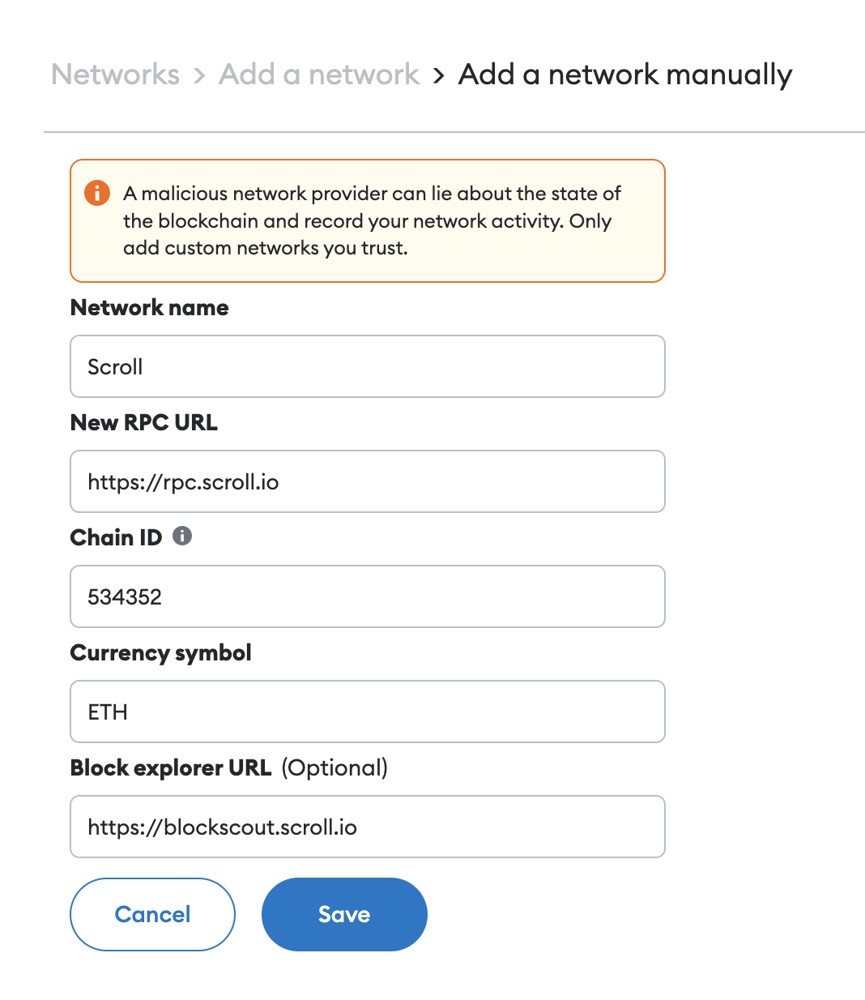

# WTF Scroll开发入门: 1. Hello Scroll

这个教程会教大家如何在Scroll上开发智能合约。

推特：[@0xAA_Science](https://twitter.com/0xAA_Science)

社区：[Discord](https://discord.gg/5akcruXrsk)｜[微信群](https://docs.google.com/forms/d/e/1FAIpQLSe4KGT8Sh6sJ7hedQRuIYirOoZK_85miz3dw7vA1-YjodgJ-A/viewform?usp=sf_link)｜[官网 wtf.academy](https://wtf.academy)

所有代码和教程开源在github: [github.com/WTFAcademy/WTF-Scroll](https://github.com/WTFAcademy/WTF-Scroll)

-----

Scroll是一个EVM等效的zkRollup以太坊扩容方案。由于和EVM等效，以太坊的开发者可以很容易的迁移到Scroll上进行开发。这一讲，我们将介绍如何连接Scroll主网，并把ETH跨链到Scroll。

## 连接Scroll主网

下面使用官方 RPC。其他节点和工具见 [Scroll 官方文档](https://docs.scroll.io/en/developers/tooling-deployed-on-scroll)。

```
Network Name: Scroll
RPC: https://rpc.scroll.io
Chain ID: 534352
Currency Symbol: ETH
Block explorer URL: https://scrollscan.com
```

你可以按照下面的截图在Metamask中添加Scroll主网：



或点击链接：[ChainList - Scroll](https://chainlist.org/?search=scroll)

## 将ETH跨链到Scroll主网

打开 [Scroll 官方桥](https://portal.scroll.io/bridge)，选择从以太坊主网转入 Scroll。连接钱包并输入金额后，核对桥页面显示的接收地址和费用，再确认交易。提交后可在桥页面检查进度。有关到账状态的说明，见 [跨链桥常见问题](https://portal.scroll.io/bridge/faq)。

## 总结

这一讲，我们简单的介绍了Scroll，如何将钱包连接到Scroll主网，并通过跨链桥将以太坊主网的ETH跨链到Scroll。
